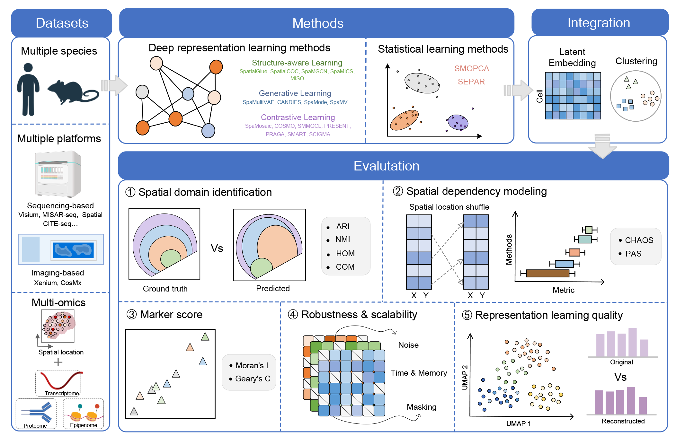

# SpaMBench: Spatial Multi-omics Benchmark

SpaMBench is a benchmark for evaluating spatial multi-omics integration methods across diverse datasets, tasks, and perturbation settings. This repository provides the benchmark pipelines, evaluation and visualization code, and dataset documentation.

## Framework

## Dataset

The benchmark includes 16 spatial datasets. Dataset names, platforms, sample counts, annotated cell types, and reference cluster numbers are listed in [DATASETS.md](datasets/DATASETS.md).

The datasets can be found at **[dataset repository link to be added]**.

## Methods

The table lists the multi-omics methods implemented in this benchmark and links to their original repositories. Benchmark scripts are organized under `Benchmark/Multi-omics Methods/` by method and input modality.

| Method | Original repository |
|---|---|
| CANDIES | [YeLiu-Lab/CANDIES](https://github.com/YeLiu-Lab/CANDIES) |
| COSMOS | [Lin-Xu-lab/COSMOS](https://github.com/Lin-Xu-lab/COSMOS) |
| MISO | [kpcoleman/miso](https://github.com/kpcoleman/miso) |
| PRESENT | [lizhen18THU/PRESENT](https://github.com/lizhen18THU/PRESENT) |
| PRAGA | [Xubin-s-Lab/PRAGA](https://github.com/Xubin-s-Lab/PRAGA) |
| SCIGMA | [YMa-lab/SCIGMA](https://github.com/YMa-lab/SCIGMA) |
| SEPAR | [zerovain/SEPAR](https://github.com/zerovain/SEPAR) |
| SMART | [Xubin-s-Lab/SMART-main](https://github.com/Xubin-s-Lab/SMART-main) |
| SMMGCL | [cs-wangbo/SMMGCL](https://github.com/cs-wangbo/SMMGCL) |
| SMOPCA | [cmhimself/SMOPCA](https://github.com/cmhimself/SMOPCA) |
| SpaMGCN | [hongfeiZhang-source/spaMGCN](https://github.com/hongfeiZhang-source/spaMGCN) |
| SpaMICS | [SZU-CGC/SpaMICS](https://github.com/SZU-CGC/SpaMICS) |
| SpaMode | [bridge1924/SpaMode](https://github.com/bridge1924/SpaMode) |
| SpaMosaic | [JinmiaoChenLab/SpaMosaic](https://github.com/JinmiaoChenLab/SpaMosaic) |
| SpaMultiVAE | [ttgump/spaVAE](https://github.com/ttgump/spaVAE) |
| SpaMV | [ericcombiolab/SpaMV](https://github.com/ericcombiolab/SpaMV) |
| SpatialCOC | [xjtu-omics/SpatialCOC](https://github.com/xjtu-omics/SpatialCOC) |
| SpatialGlue | [JinmiaoChenLab/SpatialGlue](https://github.com/JinmiaoChenLab/SpatialGlue) |

### Environment setup

Each method has its own software requirements. We recommend creating a separate environment for each method and following the installation instructions and dependency versions in its linked original repository. The benchmark scripts provide the dataset-specific input preparation, method invocation, and output handling used in our experiments.

## Usage

The repository is organized by task:

- `Benchmark/Multi-omics Methods/` contains the 18 multi-omics benchmark pipelines. Where both input combinations are supported, separate scripts are provided for RNA+ADT and RNA+ATAC.
- `Benchmark/Single-omic Methods/` contains the 3 single-omics baseline pipelines.
- `Eval/` contains the evaluation functions used in this study.
- `visualization/` contains plotting scripts for spatial-domain maps and benchmark boxplots.
- `Impact analysis/` contains code and notebooks for masking, noise, spatial-coordinate perturbation, and post-processing analyses.
- `datasets/DATASETS.md` documents the datasets, sample counts, labels, and reference cluster numbers. 

Before running a pipeline, install the environment specified by that method's original repository and check or update the script's input and output paths for your local directory layout. 
